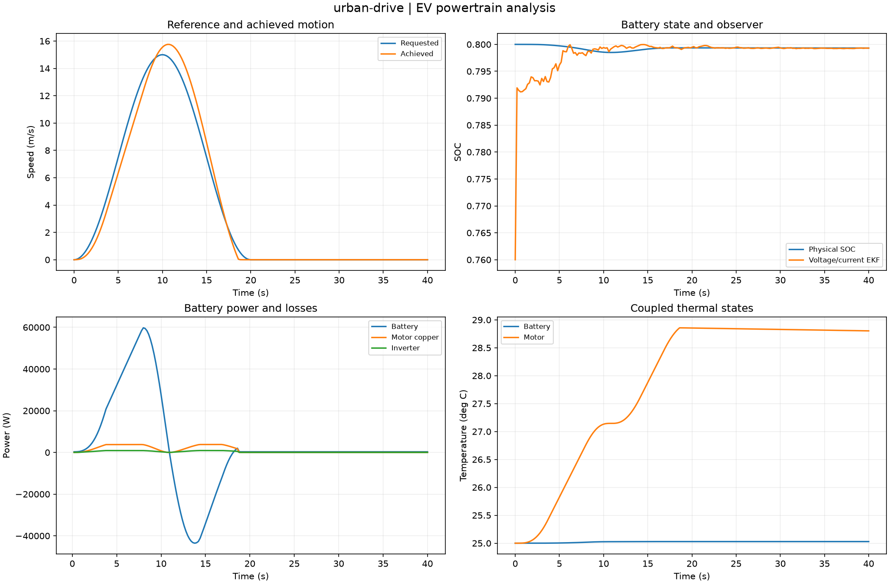
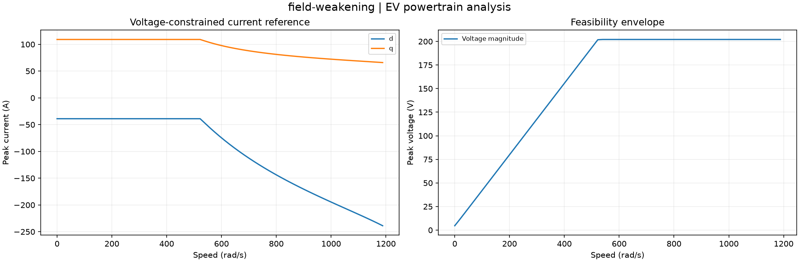
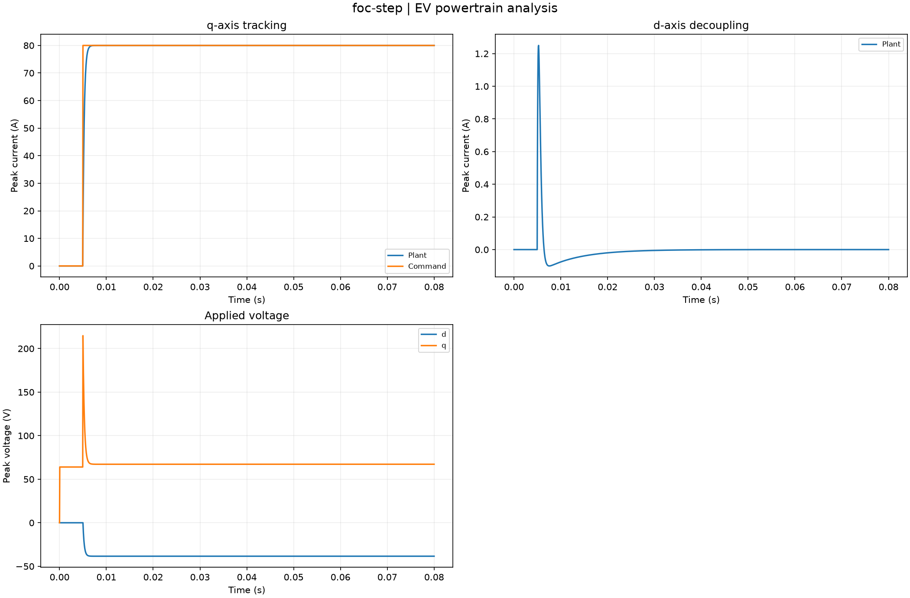
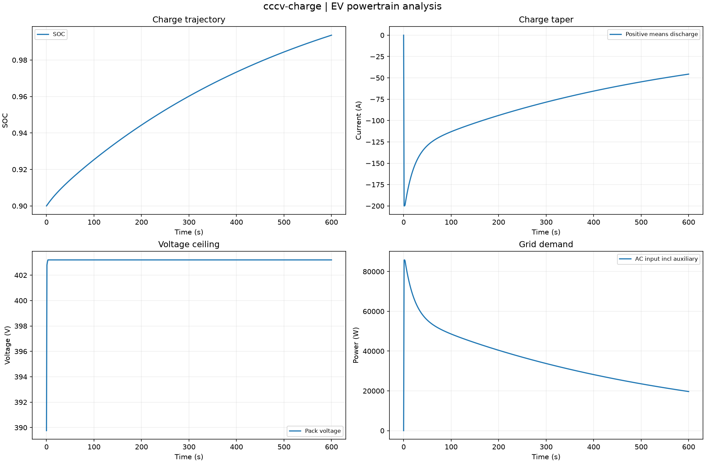
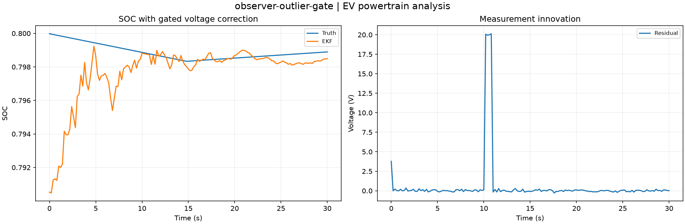

# Computed experiment gallery

Twenty-four default studies computed from clean source revision [`f76abf4e92fc`](https://github.com/VictorOdoyo/ev-powertrain-lab/commit/f76abf4e92fcad76f09c382695c29ff51b7d2a71).
All values below come from the sealed captures. Each case directory contains the complete
NPZ arrays, CSV tables, parameters, provenance, plot and HTML report.

HTML files can be opened locally; GitHub previews the figures and tables directly.

| Study | Selected measured outputs | Artifacts |
| --- | --- | --- |
| [battery-hysteresis](gallery/battery-hysteresis/figure.png) | final_hysteresis_v = 0.899964 | [summary](gallery/battery-hysteresis/summary.csv), [setup](gallery/battery-hysteresis/parameters.json), [archive](gallery/battery-hysteresis/fields.npz), [report](gallery/battery-hysteresis/index.html) |
| [online-resistance](gallery/online-resistance/figure.png) | final_resistance_ohm = 0.0640079 | [summary](gallery/online-resistance/summary.csv), [setup](gallery/online-resistance/parameters.json), [archive](gallery/online-resistance/fields.npz), [report](gallery/online-resistance/index.html) |
| [tire-envelope](gallery/tire-envelope/figure.png) | maximum_circle_residual_n2 = 1.86265e-09 | [summary](gallery/tire-envelope/summary.csv), [setup](gallery/tire-envelope/parameters.json), [archive](gallery/tire-envelope/fields.npz), [report](gallery/tire-envelope/index.html) |
| [dc-precharge](gallery/dc-precharge/figure.png) | energy_defect_j = 5.68434e-13; final_link_v = 397.305 | [summary](gallery/dc-precharge/summary.csv), [setup](gallery/dc-precharge/parameters.json), [archive](gallery/dc-precharge/fields.npz), [report](gallery/dc-precharge/index.html) |
| [pack-impedance](gallery/pack-impedance/figure.png) | r0_ohm = 0.064; r1_ohm = 0.032 | [summary](gallery/pack-impedance/summary.csv), [setup](gallery/pack-impedance/parameters.json), [archive](gallery/pack-impedance/fields.npz), [report](gallery/pack-impedance/index.html) |
| [road-load-uncertainty](gallery/road-load-uncertainty/figure.png) | traction_interval_wh = [119.22802507715139, 130.0423281582703, 141.2543575109097] | [summary](gallery/road-load-uncertainty/summary.csv), [setup](gallery/road-load-uncertainty/parameters.json), [archive](gallery/road-load-uncertainty/fields.npz), [report](gallery/road-load-uncertainty/index.html) |
| [observer-outlier-gate](gallery/observer-outlier-gate/figure.png) | rejected_samples = 4 | [summary](gallery/observer-outlier-gate/summary.csv), [setup](gallery/observer-outlier-gate/parameters.json), [archive](gallery/observer-outlier-gate/fields.npz), [report](gallery/observer-outlier-gate/index.html) |
| [urban-drive](gallery/urban-drive/figure.png) | distance_m = 149.419; final_soc = 0.799319 | [summary](gallery/urban-drive/summary.csv), [setup](gallery/urban-drive/parameters.json), [archive](gallery/urban-drive/fields.npz), [report](gallery/urban-drive/index.html) |
| [highway-drive](gallery/highway-drive/figure.png) | distance_m = 819.882; final_soc = 0.793504 | [summary](gallery/highway-drive/summary.csv), [setup](gallery/highway-drive/parameters.json), [archive](gallery/highway-drive/fields.npz), [report](gallery/highway-drive/index.html) |
| [hill-drive](gallery/hill-drive/figure.png) | distance_m = 607.199; final_soc = 0.797359 | [summary](gallery/hill-drive/summary.csv), [setup](gallery/hill-drive/parameters.json), [archive](gallery/hill-drive/fields.npz), [report](gallery/hill-drive/index.html) |
| [friction-braking](gallery/friction-braking/figure.png) | distance_m = 149.416; final_soc = 0.798456 | [summary](gallery/friction-braking/summary.csv), [setup](gallery/friction-braking/parameters.json), [archive](gallery/friction-braking/fields.npz), [report](gallery/friction-braking/index.html) |
| [full-pack-braking](gallery/full-pack-braking/figure.png) | distance_m = 149.419; final_soc = 0.999254 | [summary](gallery/full-pack-braking/summary.csv), [setup](gallery/full-pack-braking/parameters.json), [archive](gallery/full-pack-braking/fields.npz), [report](gallery/full-pack-braking/index.html) |
| [hot-pack-shutdown](gallery/hot-pack-shutdown/figure.png) | distance_m = 0; final_soc = 0.8 | [summary](gallery/hot-pack-shutdown/summary.csv), [setup](gallery/hot-pack-shutdown/parameters.json), [archive](gallery/hot-pack-shutdown/fields.npz), [report](gallery/hot-pack-shutdown/index.html) |
| [biased-current-observer](gallery/biased-current-observer/figure.png) | distance_m = 149.419; final_soc = 0.799348 | [summary](gallery/biased-current-observer/summary.csv), [setup](gallery/biased-current-observer/parameters.json), [archive](gallery/biased-current-observer/fields.npz), [report](gallery/biased-current-observer/index.html) |
| [heavy-vehicle](gallery/heavy-vehicle/figure.png) | distance_m = 119.816; final_soc = 0.799069 | [summary](gallery/heavy-vehicle/summary.csv), [setup](gallery/heavy-vehicle/parameters.json), [archive](gallery/heavy-vehicle/fields.npz), [report](gallery/heavy-vehicle/index.html) |
| [hot-motor-derating](gallery/hot-motor-derating/figure.png) | distance_m = 56.2033; final_soc = 0.799775 | [summary](gallery/hot-motor-derating/summary.csv), [setup](gallery/hot-motor-derating/parameters.json), [archive](gallery/hot-motor-derating/fields.npz), [report](gallery/hot-motor-derating/index.html) |
| [foc-step](gallery/foc-step/figure.png) | final_error_a = 1.93108e-05 | [summary](gallery/foc-step/summary.csv), [setup](gallery/foc-step/parameters.json), [archive](gallery/foc-step/fields.npz), [report](gallery/foc-step/index.html) |
| [foc-delay](gallery/foc-delay/figure.png) | delayed_final_error_a = 0.00112491 | [summary](gallery/foc-delay/summary.csv), [setup](gallery/foc-delay/parameters.json), [archive](gallery/foc-delay/fields.npz), [report](gallery/foc-delay/index.html) |
| [cccv-charge](gallery/cccv-charge/figure.png) | final_soc = 0.993612; grid_wh = 6067.19 | [summary](gallery/cccv-charge/summary.csv), [setup](gallery/cccv-charge/parameters.json), [archive](gallery/cccv-charge/fields.npz), [report](gallery/cccv-charge/index.html) |
| [field-weakening](gallery/field-weakening/figure.png) | feasible_fraction = 0.663366 | [summary](gallery/field-weakening/summary.csv), [setup](gallery/field-weakening/parameters.json), [archive](gallery/field-weakening/fields.npz), [report](gallery/field-weakening/index.html) |
| [mtpa-reference](gallery/mtpa-reference/figure.png) | maximum_independent_error_a = 4.155e-06 | [summary](gallery/mtpa-reference/summary.csv), [setup](gallery/mtpa-reference/parameters.json), [archive](gallery/mtpa-reference/fields.npz), [report](gallery/mtpa-reference/index.html) |
| [battery-pulse](gallery/battery-pulse/figure.png) | final_soc = 0.694444 | [summary](gallery/battery-pulse/summary.csv), [setup](gallery/battery-pulse/parameters.json), [archive](gallery/battery-pulse/fields.npz), [report](gallery/battery-pulse/index.html) |
| [thermal-network](gallery/thermal-network/figure.png) | maximum_energy_drift_j = 3.49246e-10 | [summary](gallery/thermal-network/summary.csv), [setup](gallery/thermal-network/parameters.json), [archive](gallery/thermal-network/fields.npz), [report](gallery/thermal-network/index.html) |
| [svpwm-average](gallery/svpwm-average/figure.png) | maximum_average_error_v = 7.65278e-14 | [summary](gallery/svpwm-average/summary.csv), [setup](gallery/svpwm-average/parameters.json), [archive](gallery/svpwm-average/fields.npz), [report](gallery/svpwm-average/index.html) |

## Selected fields and diagnostics

### urban-drive

### field-weakening

### foc-step

### cccv-charge

### observer-outlier-gate

## Interpretation

These are synthetic numerical studies. Main vehicle trajectories use quasi-steady feasible motor points; the FOC bench resolves fast electrical states. Coefficients are illustrative and uncalibrated. Road-load uncertainty is a prescribed-speed wheel-work envelope, not achieved battery range.

Reproduce with `evlab batch --data-only --output outputs/catalog`, then `evlab render outputs/catalog` and `evlab verify outputs/catalog`. Replay retains the original solve provenance.
